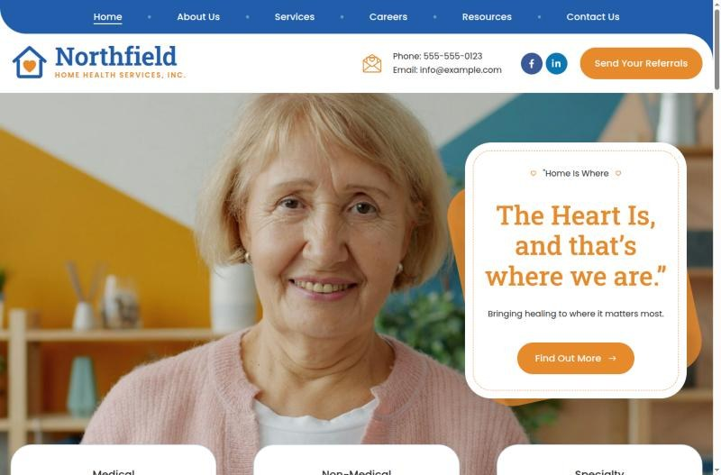
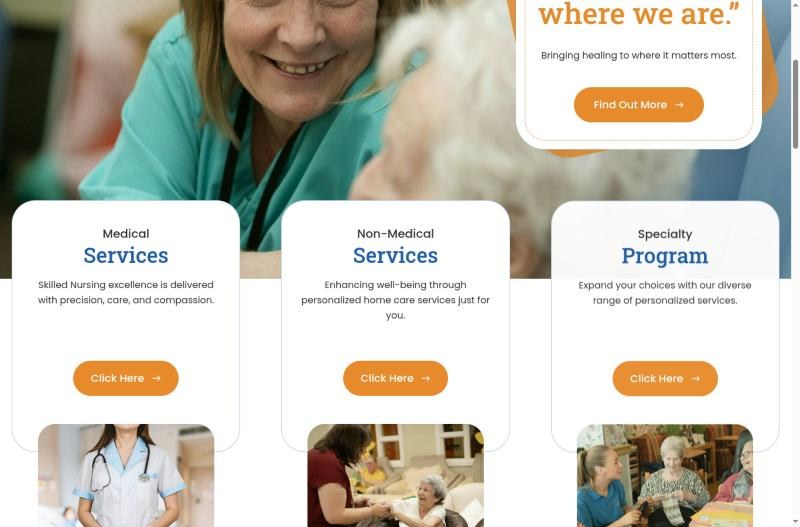
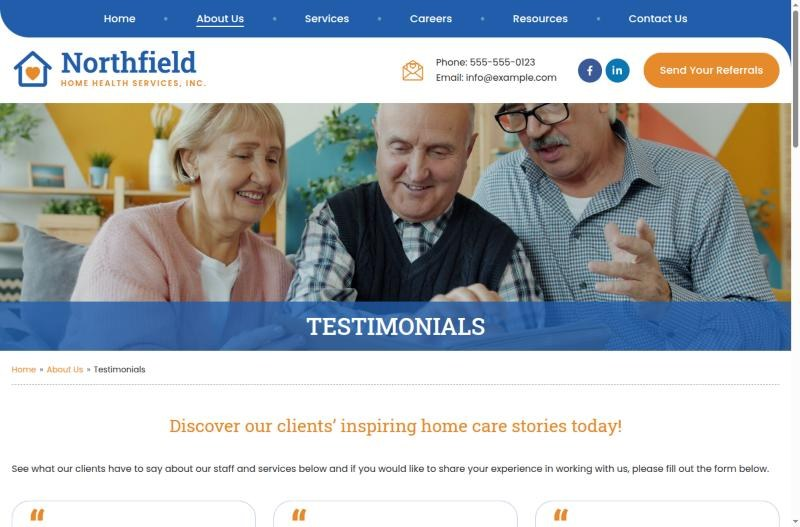
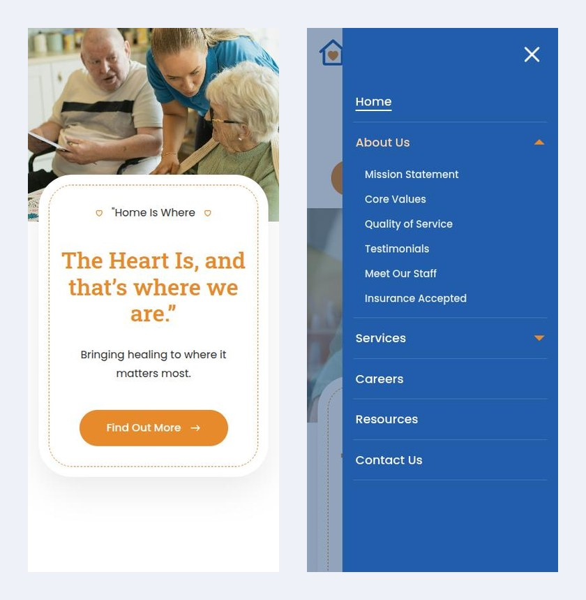

# Northfield Home Health — Custom Healthcare WordPress Theme

A hand-built classic WordPress theme for a home health care agency, rebuilt from an existing agency
website's design. The brand ("Northfield Home Health Services, Inc."), people's names and contact
details are fictional.

**[▶ Live demo in WordPress Playground](https://playground.wordpress.net/?blueprint-url=https://raw.githubusercontent.com/Rosvie/wp-theme-healthcare/main/dev/blueprint.json)**:
runs a full WordPress site with the theme and demo content in your browser. Nothing to install;
it takes about 20 seconds to boot.



| Service cards | Inner page (featured-image banner) |
| --- | --- |
|  |  |

<p align="center"></p>

## Highlights

- **No page builder, no framework.** Pure PHP templates, ~1,400 lines of hand-written CSS and a
  ~120-line vanilla JS file. No jQuery, no build step.
- **Pixel-faithful layout work:** overlapping hero card on a rotated accent shape, service cards that
  rise into the hero, a circular "Meet Our Staff" badge breaking out of its image, action boxes that
  straddle two sections, and a nav bar with a concave corner done purely in CSS (`radial-gradient`).
- **Responsive from 320px up:** an off-canvas mobile menu with tap-to-expand submenus, Escape-to-close and
  click-outside handling; every layout is re-flowed (not just shrunk) at 1280 / 1100 / 1024 / 768 / 480px.
- **Five accessible forms** (contact, appointment, referral, job application with resume upload,
  testimonial) generated from one data-driven definition array, with server-side validation, a nonce,
  a honeypot, file-type/size checks and email delivery via `wp_mail()`.
- **Editable without code:** the Customizer controls the logo text, contact details, social links,
  header button, map and hero banner; menus, page content and banner images are standard WordPress.

## Tech

PHP 7.4+ · WordPress 6.4+ (tested on 7.1) · CSS custom properties, Grid and Flexbox ·
Vanilla JS (IntersectionObserver) · Docker for local development

## Run it locally

Requires Docker.

```bash
git clone <this-repo> northfield-home-health
cd northfield-home-health/dev
./setup.sh
```

This starts WordPress + MariaDB, installs WordPress, activates the theme and loads the demo pages and
menus. Open <http://localhost:8080> (admin: `/wp-admin`, `admin` / `admin`; for local use only).
Use another port with `WP_PORT=8090 ./setup.sh`. Stop with `docker compose down` (add `-v` to wipe the database).

To use the theme on an existing site, copy this folder into `wp-content/themes/` and activate it.
A clean theme zip (without `dev/` and `docs/`) can be built with:

```bash
git archive --format=zip --prefix=northfield-home-health/ -o northfield-home-health.zip HEAD
```

## Project structure

```
├── style.css               Theme header + all styles (design tokens in :root)
├── functions.php           Setup, assets, menus, widget area
├── header.php / footer.php
├── front-page.php          Homepage sections
├── page.php, single.php, index.php, 404.php
├── template-parts/
│   └── page-banner.php     Inner-page banner (featured image + title)
├── inc/
│   ├── contact-form.php    Form definitions, rendering, submission handler, [nhh_map]
│   ├── customizer.php      Theme options + defaults
│   ├── template-tags.php   Logo, menu fallbacks, breadcrumbs, helpers
│   └── icons.php           Inline SVG icon set
├── js/theme.js             Mobile nav, hero slider, scroll reveal, back-to-top
├── images/                 Theme images
├── dev/                    Docker setup, Playground blueprint, seed script, demo content and banner images
└── docs/screenshots/
```

## Shortcodes

| Shortcode | Output |
| --- | --- |
| `[nhh_contact_form]` | Compact "Send Us a Message" form (as on the homepage) |
| `[nhh_form type="contact"]` | Full form. Types: `contact`, `appointment`, `referral`, `employment`, `testimonial` |
| `[nhh_map height="350"]` | Google Map from the Customizer setting |

Forms are defined as data in `nhh_form_definitions()`; add or change fields there or through the
`nhh_form_definitions` filter. Job positions use the `nhh_job_positions` filter. On a live server,
use an SMTP plugin so `wp_mail()` delivers reliably.

## Accessibility and performance

- Semantic landmarks, skip link, visible focus styles, labelled form fields, `aria-expanded` on the
  menu toggle, and keyboard-reachable dropdowns.
- Animations are disabled for visitors who prefer reduced motion; content is visible without JavaScript.
- Lazy-loaded below-the-fold images, `fetchpriority` on the hero, deferred script, font preconnect.

## What I'd do next

- Convert the page bodies to native blocks or block patterns so editors get visual editing.
- Add a build step for CSS minification and critical CSS.
- Add PHPCS (WordPress Coding Standards) and an automated accessibility check (axe) in CI.

## Photo credits

All photos are from [Unsplash](https://unsplash.com) under the [Unsplash License](https://unsplash.com/license)
(free to use, modify and use commercially; attribution appreciated). They were cropped and resized for the theme.

| File | Photographer |
| --- | --- |
| `images/slider/1.jpg (mirrored)` | [Age Cymru](https://unsplash.com/photos/qW3DLnehg9w) |
| `images/slider/2.jpg` | [Age Cymru](https://unsplash.com/photos/bSXk1lOp8T0) |
| `images/slider/3.jpg` | [Vitaly Gariev](https://unsplash.com/photos/IihDS3WZGlY) |
| `images/service-medical.jpg` | [JESHOOTS.COM](https://unsplash.com/photos/l0j0DHVWcIE) |
| `images/service-non-medical.jpg` | [Age Cymru](https://unsplash.com/photos/2obyM4zYt3Y) |
| `images/service-specialty.jpg` | [Age Cymru](https://unsplash.com/photos/GStFfDrOygo) |
| `images/careers.jpg` | [Age Cymru](https://unsplash.com/photos/dMhB7w99ju8) |
| `images/main-img.jpg` | [Age Cymru](https://unsplash.com/photos/GPrh_GLiWCI) |
| `images/btm1-bg.jpg` | [Age Cymru](https://unsplash.com/photos/iMTRPLdReVo) |
| `images/ftr-bg.jpg` | [Katja Rooke](https://unsplash.com/photos/77JACslA8G0) |
| `images/inner-banner.jpg` | [Clay Banks](https://unsplash.com/photos/4iTQFfuiFzc) |
| `dev/demo-images/about.jpg` | [Vitaly Gariev](https://unsplash.com/photos/IuocpNR7s74) |
| `dev/demo-images/services.jpg` | [Age Cymru](https://unsplash.com/photos/D394dKgOjec) |
| `dev/demo-images/careers.jpg` | [Mateo Hernandez Reyes](https://unsplash.com/photos/YgY1ITp8PMM) |
| `dev/demo-images/contact.jpg` | [Vitaly Gariev](https://unsplash.com/photos/-FYWsRxATAE) |
| `dev/demo-images/resources.jpg` | [Land O'Lakes, Inc.](https://unsplash.com/photos/7BXmH9YzNAI) |
| `dev/demo-images/staff.jpg` | [Nappy](https://unsplash.com/photos/6LV3V1gLrP8) |

The footer badges (`images/badge-accredited.svg`, `images/badge-medicare.svg`) are generic placeholders drawn
for this theme, not real accreditation marks. Swap in the agency's actual accreditation logos for a real site.

## License

GPL-2.0-or-later, like WordPress itself.
